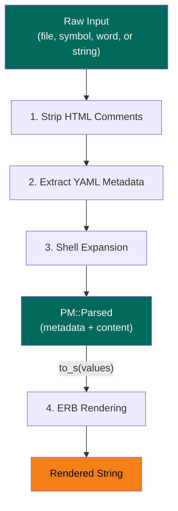
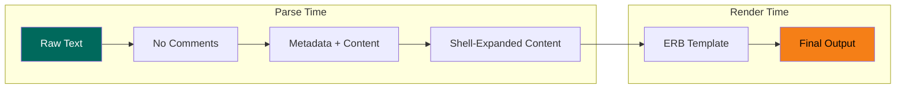

# Processing Pipeline

PM processes prompts through a four-stage pipeline. The first three stages run at parse time; the fourth runs on demand when `to_s` is called.

## Overview



## Stage 1: Strip HTML Comments

**When:** Parse time
**Method:** `PM.strip_comments`

All `<!-- ... -->` comments are removed, including multiline spans. This runs first so comments don't interfere with metadata extraction.

```
Input:  "<!-- draft -->\n---\ntitle: Test\n---\nContent <!-- note -->"
Output: "\n---\ntitle: Test\n---\nContent "
```

## Stage 2: Extract YAML Metadata

**When:** Parse time
**Regex:** `PM::METADATA_REGEXP`

The `---`-delimited front matter is parsed with `YAML.safe_load` (permitting `Date` and `Time`) into a Hash, validated, and wrapped in a `PM::Metadata` object:

- The front matter must be a mapping (or empty); anything else raises `PM::MetadataError`.
- `shell` and `erb` are coerced to booleans. When the file does not set one, or the configuration is locked, the global default is used.
- `parameters` must be a mapping when present.

For file sources, `directory`, `name`, `created_at`, and `modified_at` are added from file stats.

```
Input:  "---\ntitle: Test\nshell: true\n---\nContent"
Output: metadata = PM::Metadata(title: "Test", shell: true, erb: true)
        content  = "Content"
```

## Stage 3: Shell Expansion

**When:** Parse time (if `shell: true`)
**Method:** `PM.expand_shell`
**Class:** `PM::ShellExpander`

A single left-to-right scan over the content (`StringScanner`). At each position the
expander handles exactly one of:

| Seen | Action |
|---|---|
| A fence line (``` or ~~~) at the start of a line | Copy lines verbatim until the matching closing fence |
| `\$` | Emit a literal `$` |
| `$(` | Read to the matching `)`, run the command with `Open3.capture3`, emit stdout (chomped) |
| `$VAR` or `${VAR}` | Emit `ENV.fetch(name, '')` |
| Anything else | Copy one character |

Command output is appended to the result and the scan continues **after** the `$(...)`
in the source, so output is never re-expanded. When the prompt has `erb: true`, `<%`
in output or in an environment variable's value becomes `<%%` so stage 4 treats it
as text.

```
Input:  "User: $USER\nDate: $(date +%Y-%m-%d)"
Output: "User: dewayne\nDate: 2026-11-01"
```

Errors: `PM::ShellCommandError` for a non-zero exit, `PM::ShellExpansionError` for an unmatched `$(`.

## Stage 4: ERB Rendering

**When:** On demand (`to_s` call, if `erb: true`)
**Classes:** `PM::Renderer`, `PM::RenderScope`

`Renderer` merges parameter defaults with the `to_s` arguments, checks required
parameters, builds a `PM::RenderContext`, and evaluates the content as ERB against a
`RenderScope`. The scope resolves bare names: parameter (no arguments) → directive →
`nil` (or `PM::UnknownParameterError` in strict mode).

This stage also handles the `include` directive, which parses the child through
stages 1 to 3 and renders it through stage 4 with the same parameters, a depth one
greater, and the ancestor chain extended by the current file.

```
Input:  "Hello, <%= name %>!"  (with params: {name: "Alice"})
Output: "Hello, Alice!"
```

## Conditional Stages

Stages 3 and 4 can be independently disabled:

| Setting | Effect |
|---------|--------|
| `shell: false` | Stage 3 skipped; `$VAR` and `$(cmd)` preserved |
| `erb: false` | Stage 4 skipped; `<%= ... %>` preserved; directives do not run |

Settings can be per-file (YAML metadata) or global (`PM.configure`). Per-file wins
unless the configuration is locked with `PM.config.lock!`, in which case the global
value is final.

## Data Flow



The `PM::Parsed` object returned by `PM.parse` holds the result of stages 1-3. Calling `to_s` triggers stage 4 and returns the final string.
