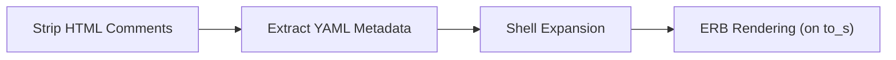

# PM (PromptManager)

<table>
<tr>
<td width="40%" align="center" valign="top">
  <br>
  <em>"Prompts with superpowers"</em>
</td>
<td width="60%" valign="top">
<strong>Parse YAML front matter from markdown, expand shell references, compose prompts from other files, and render ERB on demand.</strong><br><br>
PM (PromptManager) treats a prompt file as a composable, parameterized template. Write prompts in markdown with YAML front matter, shell references, and ERB. PM handles the rest.

<h3>Key Features</h3>
<ul>
<li><strong>YAML Metadata</strong> - Parse from markdown strings or files</li>
<li><strong>Shell Expansion</strong> - <code>$VAR</code>, <code>${VAR}</code>, <code>$(command)</code>; <code>\$</code> escapes; code fences are skipped</li>
<li><strong>ERB Rendering</strong> - On-demand rendering with required and default parameters</li>
<li><strong>File Includes</strong> - Compose prompts from multiple files with a tracked include tree</li>
<li><strong>Raw Inserts</strong> - Drop any file in verbatim</li>
<li><strong>Custom Directives</strong> - Blocks or <code>PM::Directive</code> subclasses, callable from ERB</li>
<li><strong>Configurable Pipeline</strong> - Enable, disable, or lock stages per prompt or globally</li>
<li><strong>Typed Errors</strong> - A <code>PM::Error</code> hierarchy for everything PM raises</li>
<li><strong>Comment Stripping</strong> - HTML comments removed before processing</li>
<li><strong>Zero runtime dependencies</strong> - Ruby 4.0.9+ and its standard library</li>
</ul>
</td>
</tr>
</table>

## Processing Pipeline

Every prompt passes through four stages:



1. **Strip HTML comments** -- `<!-- ... -->` removed before anything else
2. **Extract YAML metadata** -- Front matter between `---` fences parsed into `PM::Metadata`
3. **Shell expansion** -- Environment variables and commands expanded (when `shell: true`)
4. **ERB rendering** -- Templates evaluated on demand when `to_s` is called (when `erb: true`)

## Quick Example

Given a file `review.md`:

```markdown
---
title: Code Review
parameters:
  language: ruby
  code: null
---
Review the following <%= language %> code:

<%= code %>
```

Parse and render:

```ruby
require 'pm'

parsed = PM.parse('review.md')
puts parsed.metadata.title        #=> "Code Review"
puts parsed.to_s('code' => source) #=> rendered prompt
```

## A word on trust

A prompt file can run Ruby (ERB), run shell commands (`$(...)`), and read any file
(`include` / `insert`). Treat prompt files as code and read the
[Security guide](guides/security.md) before parsing files you did not write.

## Getting Started

Head to [Installation](getting-started/installation.md) to add PM to your project, then follow the [Quick Start](getting-started/quick-start.md) guide.
